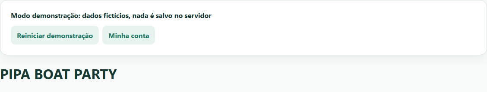
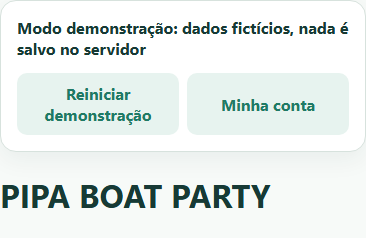
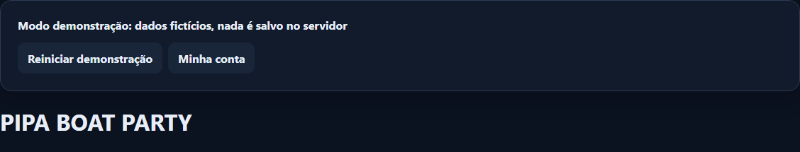

# Controle-App

<p align="center">
  
</p>

<p align="center">
  <a href="https://vite.dev/"></a>
  <a href="https://react.dev/"></a>
  <a href="https://www.typescriptlang.org/"></a>
  <a href="https://supabase.com/"></a>
  <a href="https://web.dev/progressive-web-apps/"></a>
  <a href="https://pages.github.com/"></a>
</p>

Aplicação PWA multiempresa para controle de estoque, compras, vendas, inventário, equipe e auditoria. O projeto inclui operação offline segura para movimentações simples, políticas de acesso por cargo, suporte privado e implantação preparada para Supabase.

- **Aplicação:** https://dev-aylton.github.io/Controle-App/
- **Modo demonstração:** https://dev-aylton.github.io/Controle-App/#/demo
- **Acompanhamento do projeto:** https://dev-aylton.github.io/Controle-App/docs/acompanhamento/plano/

## Funcionalidades

- **Ambientes e produtos:** categorias, múltiplos ambientes, custo, mínimo/máximo, volume e dose.
- **Movimentações:** formulário e lote manual, entradas, saídas, perdas, transferências, dose/garrafa aberta, estorno e zeragem.
- **Inventário:** contagem cega, importação oficial CSV/XLSX, diferenças entre contagens e finalização por gerente/proprietário.
- **Compras:** sugestões por ambiente, múltiplos fornecedores, preços, rascunho editável, paginação, exportação CSV/PDF e solicitações de reposição não bloqueantes.
- **Gestão:** central de alertas, dashboard diário, saldo negativo, perdas sem motivo, categorias de notificação e urgência visual.
- **Relatórios:** movimentações, auditoria e exportação CSV segura contra injeção de fórmula.
- **Vendas:** preços e custos por ambiente, preço automático por dose, importação CSV/XLSX, mapeamento, ficha técnica, prévia financeira, histórico e desfazimento.
- **Offline:** catálogo e fila de movimentações isolados por usuário; entradas, saídas e transferências simples sincronizam ao reconectar com identificador idempotente.
- **Suporte:** chat privado usuário-administrador, anexos, leitura, arquivamento, ocultação e contador no sino.
- **Privacidade:** política 1.3.0, aceite versionado, exportação de dados, pedido de exclusão em 90 dias e histórico preservado.
- **Acesso administrativo:** suspensão e reativação de empresas, desativação e reativação de funcionários e auditoria das ações de suporte.
- **Demonstração:** empresa fictícia, troca de cargo e operações locais sem login ou Supabase.

## Fluxo operacional recomendado

1. **Configure a empresa e os ambientes** para separar o estoque central e cada ponto de venda.
2. **Cadastre produtos** com unidade, custo, níveis mínimo/máximo e, quando aplicável, volume e dose.
3. **Configure preços por ambiente** em Preços de venda; depois registre entradas, perdas e transferências e importe vendas para calcular faturamento e CMV enquanto baixa o estoque.
4. **Confira saldos e faça inventários** para comparar a contagem física com o saldo registrado.
5. **Use alertas e a lista de compras** para priorizar reposições; consulte relatórios e auditoria para revisar o histórico.

Preços por unidade ou dose precisam estar cadastrados para calcular a venda. A importação exige saldo suficiente e é aplicada em lote. O custo por ambiente é opcional e usa o custo base quando necessário.

## Cargos e permissões

| Área | Admin/suporte | Proprietário | Gerente | Funcionário |
|---|---:|---:|---:|---:|
| Cadastrar produtos novos | Sim | Sim | Sim | Sim |
| Editar ou desativar produtos existentes | Sim | Sim | Sim | Não |
| Cadastrar ou editar ambientes | Sim | Sim | Sim | Não |
| Consultar produtos e ambientes cadastrados | Sim | Sim | Sim | Sim, somente leitura |
| Importar produtos e vendas | Sim | Sim | Sim | Não |
| Lançar e estornar movimentações | Sim | Sim | Sim | Sim, conforme regra |
| Finalizar inventário e zerar estoque | Sim | Sim | Sim | Não |
| Saldo por ambiente | Sim | Sim | Sim | Sim |
| Custo, compra, histórico e relatórios | Sim | Sim | Sim | Não |
| Equipe e código da empresa | Sim | Sim | Parcial | Não |
| Auditoria | Sim | Sim | Sim | Não |
| Suspender ou reativar empresa | Sim | Não | Não | Não |
| Chat de suporte | Sim, caixa administrativa | Sim, conversa própria | Sim, conversa própria | Sim, conversa própria |
| Desativar ou reativar membros | Sim | Conforme cargo | Somente funcionários | Não |

Funcionários novos entram pela RPC `join_company_with_code`: o vínculo como funcionário é criado imediatamente e já pode trabalhar, **sem aprovação prévia**.

## Decisões técnicas

- **RLS:** tabelas e operações protegidas por Row Level Security e grants mínimos.
- **Isolamento multiempresa:** produto, ambiente e outros objetos são validados na empresa correta.
- **Imutabilidade:** `stock_movements` não permite UPDATE/DELETE; correções são feitas por estorno.
- **Funções protegidas:** RPCs críticas são `SECURITY DEFINER`, usam `search_path` fixo e checagens NULL-safe.
- **Idempotência:** lançamentos offline enviam `client_request_id` para evitar duplicação.
- **Privacidade local:** fila offline filtrada por usuário; registros antigos sem vínculo não são exibidos nem enviados.
- **Auditoria:** ações do admin recebem a marca `acted_as_support`; auditoria bloqueia alteração e exclusão.
- **Saldo:** transferências e importações de venda exigem saldo suficiente; divergências de movimentações continuam auditadas.
- **Ambientes separados:** o projeto mantém banco real e banco de testes separados.
- **Performance:** telas carregadas por rota; listas extensas usam paginação; XLSX e PDF são carregados sob demanda.
- **Privacidade:** sessão e fila permanecem locais durante uso autorizado; a saída limpa dados locais da conta sem apagar histórico empresarial.

## Arquitetura

```text
React + PWA
  ├── Dexie / IndexedDB
  │     └── catálogo local e fila idempotente de movimentações
  ├── Supabase Auth
  ├── PostgreSQL + RLS
  │     ├── RPCs SECURITY DEFINER
  │     ├── auditabilidade e estornos
  │     └── isolamento entre empresas
  └── Supabase Storage / Edge Functions
        └── fotos, anexos e finalização de exclusão de conta
```

O frontend protege a experiência por cargo, mas as regras críticas de estoque, segurança e multi-tenancy são validadas no PostgreSQL por RLS e funções protegidas.

## Stack

React 19, TypeScript, Vite 8, React Router, Supabase/PostgreSQL, Dexie/IndexedDB, Papaparse, XLSX, Vitest e Playwright.

## Executar localmente

```bash
npm ci
cp .env.example .env.local
npm run dev
```

No Windows:

```powershell
npm.cmd ci
npm.cmd run dev
```

Configure somente as variáveis públicas `VITE_SUPABASE_URL` e `VITE_SUPABASE_ANON_KEY`.

## Testes

```bash
npm test
npm run lint
npx playwright test
npx playwright test --config playwright.company.config.ts
npm run sql:validar
npm run test:rls
```

- **Vitest:** suíte unitária do domínio e regras da interface.
- **RLS:** testes em `tests/rls/`, executados contra o projeto Supabase de testes.
- **Playwright:** suíte da demonstração em `tests/e2e/` e fluxo da empresa com Supabase simulado em `tests/company-e2e/`.
- **SQL:** 16 migrations e 42 patches validados; ordem e rollback documentados em `supabase/DEPLOY.md`.


## Estrutura principal

```text
src/
  components/        componentes compartilhados e navegação
  features/          regras e serviços por domínio
  pages/             telas da aplicação
  services/          integração com Supabase
supabase/
  migrations/        migrations por etapa
  patches/           correções para bancos já instalados
tests/
  rls/               testes de segurança do Supabase
  e2e/               testes Playwright da demonstração
docs/
  acompanhamento/    plano e acompanhamento de testes
  guias/             guias operacionais por cargo e engenharia
```

## Roadmap e status

O status detalhado está na [página de acompanhamento](https://dev-aylton.github.io/Controle-App/docs/acompanhamento/plano/). O release foi ensaiado no banco de testes antes da aplicação no banco real.
Os guias operacionais e técnicos estão em [docs/guias/](docs/guias/README.md).

## Telas

As capturas usam somente dados fictícios no modo demonstração. A galeria completa está organizada em [docs/screenshots/README.md](docs/screenshots/README.md).

| Notebook — gerente | Celular — gerente |
|---|---|
|  |  |

| Notebook — tema escuro | Celular — tema escuro |
|---|---|
|  |  |

### Galeria por funcionalidade

- [Início](docs/screenshots/gerente/notebook-claro/inicio.png)
- [Movimentações](docs/screenshots/gerente/notebook-claro/movimentacoes.png)
- [Produtos](docs/screenshots/gerente/notebook-claro/produtos.png)
- [Saldo por ambiente](docs/screenshots/gerente/notebook-claro/saldo-ambientes.png)
- [Inventário](docs/screenshots/gerente/notebook-claro/inventario.png)
- [Compras](docs/screenshots/gerente/notebook-claro/lista-compras.png)
- [Vendas](docs/screenshots/gerente/notebook-claro/vendas.png)
- [Relatórios e auditoria](docs/screenshots/gerente/notebook-claro/relatorios.png)
- [Equipe](docs/screenshots/gerente/notebook-claro/equipe.png)

## Autor

- [GitHub — Dev-Aylton](https://github.com/Dev-Aylton)
- [LinkedIn — Aylton Alberto](https://www.linkedin.com/in/aylton-alberto-806726220/)
- [E-mail](mailto:desenvolvedor.aylton@gmail.com)

## Licença

Todos os direitos reservados © 2026 Aylton.
