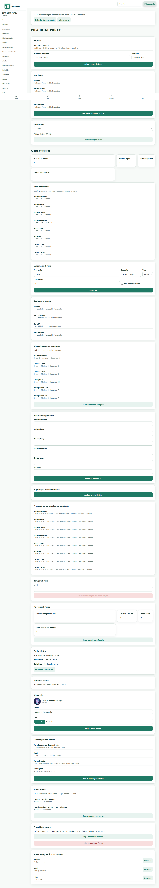
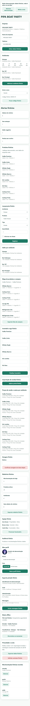
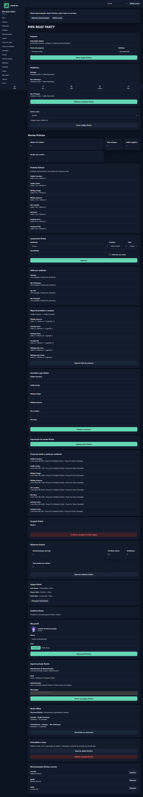
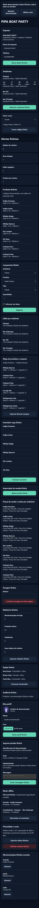

# Capturas do aplicativo

Galeria gerada pelo Playwright em modo demonstração, com dados fictícios e chamadas externas ao Supabase bloqueadas.

## Destaque

| Notebook 1440 px | Celular 390 px |
|---|---|
|  |  |
|  |  |

## Estrutura

- `gerente/notebook-claro/` e `gerente/notebook-escuro/`: telas completas do cargo gerente em 1440 px.
- `gerente/celular-claro/` e `gerente/celular-escuro/`: telas completas do cargo gerente em 390 px.
- `proprietario/notebook-claro/`, `proprietario/notebook-escuro/`, `proprietario/celular-claro/` e `proprietario/celular-escuro/`: telas completas do proprietário.
- `funcionario/notebook-claro/`, `funcionario/notebook-escuro/`, `funcionario/celular-claro/` e `funcionario/celular-escuro/`: telas disponíveis ao funcionário.

## Funcionalidades capturadas

| Funcionalidade | Notebook claro | Celular claro |
|---|---|---|
| Início | [Abrir](gerente/notebook-claro/inicio.png) | [Abrir](gerente/celular-claro/inicio.png) |
| Empresa | [Abrir](gerente/notebook-claro/empresa.png) | [Abrir](gerente/celular-claro/empresa.png) |
| Ambientes | [Abrir](gerente/notebook-claro/ambientes.png) | [Abrir](gerente/celular-claro/ambientes.png) |
| Produtos | [Abrir](gerente/notebook-claro/produtos.png) | [Abrir](gerente/celular-claro/produtos.png) |
| Movimentações | [Abrir](gerente/notebook-claro/movimentacoes.png) | [Abrir](gerente/celular-claro/movimentacoes.png) |
| Vendas | [Abrir](gerente/notebook-claro/vendas.png) | [Abrir](gerente/celular-claro/vendas.png) |
| Preços de venda | [Abrir](gerente/notebook-claro/precos-venda.png) | [Abrir](gerente/celular-claro/precos-venda.png) |
| Saldo por ambiente | [Abrir](gerente/notebook-claro/saldo-ambientes.png) | [Abrir](gerente/celular-claro/saldo-ambientes.png) |
| Inventário | [Abrir](gerente/notebook-claro/inventario.png) | [Abrir](gerente/celular-claro/inventario.png) |
| Alertas | [Abrir](gerente/notebook-claro/alertas.png) | [Abrir](gerente/celular-claro/alertas.png) |
| Lista de compras | [Abrir](gerente/notebook-claro/lista-compras.png) | [Abrir](gerente/celular-claro/lista-compras.png) |
| Relatórios | [Abrir](gerente/notebook-claro/relatorios.png) | [Abrir](gerente/celular-claro/relatorios.png) |
| Auditoria | [Abrir](gerente/notebook-claro/auditoria.png) | [Abrir](gerente/celular-claro/auditoria.png) |
| Equipe | [Abrir](gerente/notebook-claro/equipe.png) | [Abrir](gerente/celular-claro/equipe.png) |
| Perfil | [Abrir](gerente/notebook-claro/perfil.png) | [Abrir](gerente/celular-claro/perfil.png) |
| Suporte | [Abrir](gerente/notebook-claro/suporte.png) | [Abrir](gerente/celular-claro/suporte.png) |
| Offline | [Abrir](gerente/notebook-claro/offline.png) | [Abrir](gerente/celular-claro/offline.png) |
| Privacidade | [Abrir](gerente/notebook-claro/privacidade.png) | [Abrir](gerente/celular-claro/privacidade.png) |

Tema escuro disponível em cada pasta `*-escuro` correspondente ao cargo e largura.
